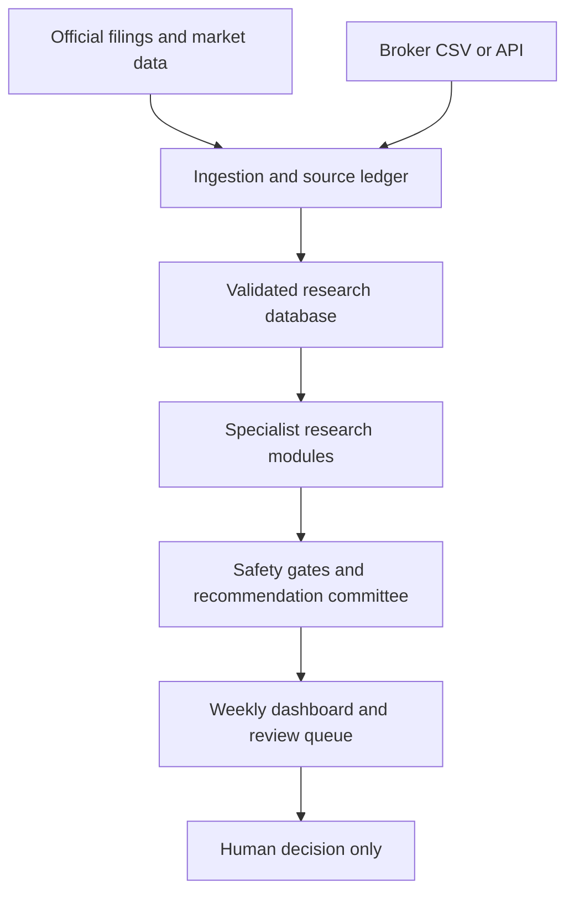

# Architecture and phased delivery

## The central design choice

Use one evidence ledger and several specialized research modules. “Agents” should not independently browse and vote from memory. Each module reads the same versioned facts, writes a structured opinion, cites its evidence, and passes through non-negotiable safety gates before a final synthesis is allowed.

## Component boundary

| Layer | Responsibility | First implementation |
|---|---|---|
| Sources | NSE/BSE filings, company reports, prices, broker holdings | CSV plus RSS/Atom/file import |
| Identity | Prevent symbol and corporate-action mix-ups | ISIN primary key; NSE/BSE mappings |
| Evidence ledger | Preserve source, time, hash, and confidence | SQLite documents and source tables |
| Research modules | Fundamentals, governance, valuation, liquidity, technicals, policy | Added in Phase 2 and 3 |
| Safety gates | Block unsupported positive recommendations | Versioned JSON policy plus quality checks |
| Recommendation ledger | Store facts, assumptions, risks, opinion, entry and exit | Append-only SQLite schema |
| Portfolio engine | Exposure, concentration, rebalance proposals | Schema now; adapter in Phase 7 |
| Interface | Priority-based weekly review | Markdown now; web dashboard later |

## Phases

### Phase 1 — trustworthy foundation (current build)

- Versioned investment policy and immutable gates.
- ISIN-based 10-company test universe.
- SQLite provenance and recommendation ledger.
- Generic CSV/URL price importer.
- RSS/Atom filing importer with hashes and evidence tiers.
- Data-quality gate and weekly Markdown report.
- No recommendation, trade, or automatic rebalance.

Exit criteria: repeatable imports, traceable source records, passing tests, and visible blocking issues when evidence is incomplete.

### Phase 2 — deterministic company research

- Standardized quarterly and annual financial facts.
- Growth quality, balance-sheet, cash conversion, dilution, and profitability checks.
- Governance red-flag rules for auditor changes, promoter pledge/sales, regulatory action, related-party issues, and suspicious announcements.
- Comparable-company and historical valuation ranges.
- Liquidity and tradability measures for small caps.

Exit criteria: every numeric conclusion can be reproduced without an LLM.

### Phase 3 — agent committee

- Fundamentals, governance, valuation, policy, technical, liquidity, and portfolio-fit modules.
- Strict JSON output per module: facts, assumptions, risks, opinion, confidence, evidence IDs, and missing data.
- Final committee runs only after every required module returns or explicitly abstains.
- Governance and data-quality vetoes override weighted scores.

Exit criteria: golden test cases show the system abstains when evidence is missing and never converts social-media hype into a primary thesis.

### Phase 4 — weekly dashboard and alerts

- Priority order: portfolio risk, portfolio opportunity, watchlist change, new opportunity, macro/policy change.
- Diff against the prior week rather than repeating unchanged facts.
- Review queue with “what changed / matters / watch / action / why / downside / exit”.
- Email or messaging notifications may be added after the dashboard is stable.

### Phase 5 — opportunity discovery

- Screen a liquid Indian-equity universe using deterministic filters first.
- Research only the short list, controlling cost and false positives.
- Separate core, growth/high-risk, speculative, watchlist-only, and avoid buckets.

### Phase 6 — backtest and calibration

- Point-in-time datasets, corporate-action adjustment, realistic costs, liquidity limits, and survivorship-bias controls.
- Blueshift can be used here as an optional strategy laboratory. Its platform code should be treated as a separate adapter, not as the master data or research system.

### Phase 7 — portfolio integration and proposed rebalancing

- Start with an ICICI Direct or other broker CSV import.
- Add Zerodha/Motilal Oswal adapters only if useful and available.
- Produce target weights, drift, tax/turnover notes, and proposed trades; require human approval.
- Never apply a “rebalance to fixed weight every bar” rule to long-term holdings without thesis, valuation, concentration, and exit checks.

### Phase 8 — controlled learning

- Score old calls at fixed horizons against Nifty sector and broad-market benchmarks.
- Separate thesis correctness, timing, and risk-control effectiveness.
- Suggest weight/confidence changes with evidence; require manual approval.
- Core safety gates remain immutable to the learner.

## Data-source policy for India

1. Official NSE/BSE announcements and SEBI disclosures.
2. Company investor-relations results, annual reports, presentations, and conference-call material.
3. Broker/exchange EOD data and licensed market-data vendors.
4. Reputable news for context.
5. Social media only as an unverified lead or sentiment input.

Google Sheets can be a convenient staging or display layer. `GOOGLEFINANCE` values may be delayed and are not an execution-grade historical-data API, so the database retains source timestamps and does not treat Google as authoritative.

## Cheap and robust deployment options

| Level | Typical monthly infrastructure | Suitable use |
|---|---:|---|
| Local-first | ₹0–₹500 | Weekly research for one user; SQLite, cron/Task Scheduler, CSV imports |
| Small cloud | ₹1,000–₹5,000 plus data/AI usage | Always-on dashboard, backups, scheduled jobs, managed secrets |
| Production-grade | ₹10,000–₹50,000+ plus licensed data | Larger universe, managed database, monitoring, queues, paid filings/market data |

These are planning bands, not vendor quotations. The largest variable is licensed Indian market/fundamental data; LLM cost stays controlled by screening first and sending only the short list to the research committee.

## Recommended deployment sequence

1. Run locally with SQLite and fixture/CSV data.
2. Add official-source collectors and daily backups.
3. Add a read-only web dashboard.
4. Move PostgreSQL and scheduled workers to a small cloud instance only when local operation becomes inconvenient.
5. Add broker access last, read-only first.

