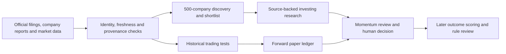

# fin-AAI: consolidated goals and execution order

Reconciled on 2026-09-24 Asia/Kolkata from the fin-AAI project tasks, related tasks run from this folder, the project log, repository, and the Momentum research blueprint. Status claims below refer to the latest recorded verification, not a fresh production audit.

## One project outcome

Build a personal Indian-equity workspace in the private Momentum site that helps the owner make better **investing** decisions and test **trading** ideas. The system should collect current, attributable evidence, calculate facts and risks with code, use bounded AI analysis with citations, keep the owner's decisions and experiments, and measure whether its calls were useful. Generating income is the motivation; profitable performance remains unproven.

The starting plan uses ₹10,000 and a planned ₹2,000 monthly contribution. Nifty 500 is the chosen discovery universe. The 500 identities and the 10 companies with verified financial profiles must remain visibly distinct until coverage expands. The first trading horizon is daily-bar swing trading. Broker selection and real-money orders come only after historical and forward paper results justify a separate decision.

## Goals, current state, and next proof

| Workstream | Agreed outcome | Last verified state | Next proof |
|---|---|---|---|
| Evidence and coverage | Dated Nifty 500 membership; official prices and filings; source-linked financial, ownership and governance evidence; honest missing-data labels | 500 discovery identities, official discovery prices for 498 normal EQ entries at the last recorded refresh, and 10 research-ready profiles. The other two were marked as BE series rather than silently treated as EQ. Python collection and Supabase synchronization exist. | Refresh to the run date, verify membership and market series, then expand full financial evidence beyond the 10 pilots in batches. Report both identity coverage and research-ready coverage. |
| Investing agent | Screen growth, cash generation, debt, governance, valuation and liquidity; create a cited, timestamped research report; abstain when evidence is insufficient | Deterministic checks, provider-neutral CLI recommendation path, and Momentum specialist review with a deterministic fallback are implemented. The latest status task found **no saved company research review**. CLI live-provider validation was not verified. | Save and inspect one ITC review in Momentum, confirm its source IDs and model/fallback label, then validate one live CLI model run separately if that path remains in scope. |
| Trading research | Specify, backtest and compare daily-bar strategies with next-session execution assumptions, costs, contributions, drawdown and holdout results | Momentum backtesting and a forward paper ledger exist. The latest read-only 10-symbol evaluator returned 19 holdout trades versus a 30-trade gate and −0.364% mean strategy return. Earlier saved tests also failed. | Freeze a revised rule before testing, evaluate it across symbols and against its same-stock benchmark, then collect forward paper trades. Keep the real-capital gate closed until it passes. |
| Agent operation and news | Two coherent investing and trading workflows, source-linked filing digests, pre-market outlook, post-market review, and later outcome scoring | A local weekday 8:30 AM / 5:00 PM Asia/Kolkata Codex heartbeat is active. The runner logs refresh, screening, prospective forecast and exact-session scoring attempts. Time-window abstention and 69 Python tests passed; the first full scheduled cycle is pending. Hosted Site finance scheduling and paper-ledger advancement remain on demand. | Inspect the first scheduled reports, fix partial source or provider failures, and verify the saved outputs before changing rules. |
| Product and release | One private Momentum dashboard for research history, watchlist, backtests and paper results | Momentum version 44 is the latest observed private version. The local automation was not deployed to the Site. Root `fin-AAI` still has substantial untracked work, so publication of the whole codebase is not established. | Reconcile source ownership and the root repository, document refresh and deployment commands, and check the live saved-data paths. |
| Learning alongside building | A day-wise, 30-minute practical finance, markets, agents and ML course tied to project implementation | Requested in a related task, with no completed course visible in its task history. | Produce a daily syllabus whose exercises use this project's filings, screens, backtests and outcome reviews. |

## Execution order

1. **Establish a trustworthy baseline.** Verify current Git/workspace ownership, the latest deployment, evidence freshness, provider connection status, and saved finance records. Update this document and `PROJECT_LOG.md` from observations rather than assuming an older report still holds.
2. **Make one investing result inspectable.** Run and save a company review, check citations, deterministic flags, timestamps and fallback labeling, and fix any remaining provider failure. This gives a real end-to-end research artifact before scaling to 500 companies.
3. **Make one trading evaluation reproducible.** Freeze a revised rule, data window and cost assumptions; run cross-symbol holdouts; compare with buy-and-hold; preserve failed tests. Begin forward paper logging only as a separate evidence stream.
4. **Broaden evidence coverage.** Screen all Nifty 500 identities with code, prioritize changes and shortlists, and add validated fundamentals in batches. Spend model calls only where source evidence is complete enough for analysis. Publish a coverage count every run.
5. **Operate on a schedule.** Observe and validate the active local 8:30 AM and 5:00 PM weekday jobs. Give every job an input snapshot, structured output, citations, status, cost and failure record. Move a proven workflow to durable hosted scheduling later. Human review controls any proposed rule change.
6. **Evaluate deployment and execution later.** Compare brokers in read-only mode if useful. Consider any live trading integration only after the historical and forward evidence is positive, adequate and reviewed, with explicit risk limits and separate authorization.

## Decisions and boundaries to preserve

- Use official exchange and company sources as primary evidence; record source identity, timestamp and document references. LLM text is interpretation of a frozen evidence packet, not a source of financial facts.
- Keep low share price separate from company value, quality and tradability. Small capital and monthly contributions are planning inputs, not a requirement to buy every month.
- Keep investing research, historical simulation, forward paper activity and any future real holdings in separate records and displays.
- Never describe the Nifty 500 list as 500 fully researched companies while only 10 have complete profiles.
- Groq and OpenRouter are supported in Momentum Settings. Provider availability, model success and source quality must be checked per run. Do not place keys in chat or commit them.
- No broker order placement, autonomous transfer of funds, invented target price or profit guarantee is part of the current product.
- The Polymarket bot discussed in a separate task is an exploratory idea for a different market. It should remain a separate paper-trading research project unless the owner explicitly adopts it into fin-AAI.

## Where the goals came from

The project task **Assess investing and trading status** established the two goals, capital plan, Momentum integration, agent aspirations, broker deferral and last deployed trading/research status. **Fin-AAI Technical Overview** added the live-data-to-recommendation goal, agent input/output specification, Nifty 500 target and daily outlook/review direction. **Run and push to new repo** recorded the Python/Supabase evidence foundation and provider-neutral recommendation path. Related tasks **Plan daily finance and ML course** and **Build autonomous Polymarket trader** are included above only where they affect this project. The patent dataset and resume-skill tasks appearing under or near this workspace have unrelated objectives and are excluded.

Detailed design and evidence: [PROJECT_LOG.md](../PROJECT_LOG.md), [architecture](ARCHITECTURE.md), [Momentum blueprint](research/momentum-blueprint.md), and [delivery checklist](DELIVERY_CHECKLIST.md).
